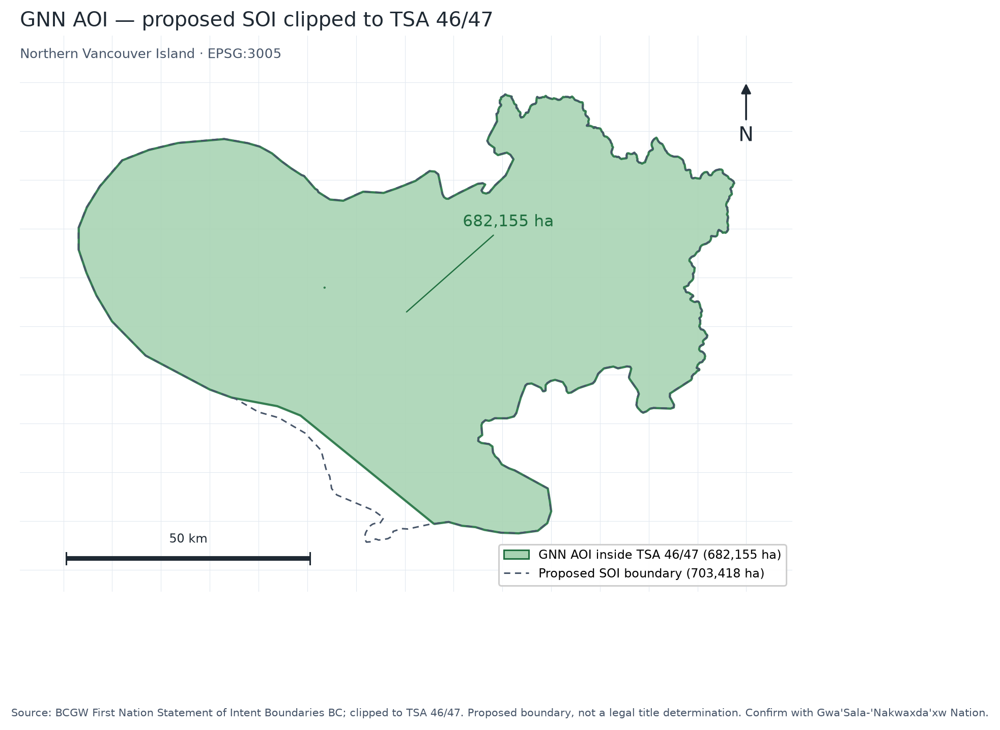

GNN AOI
=======

Boundary source
---------------

- Service: ``https://maps.gov.bc.ca/arcgis/rest/services/whse/bcgw_pub_reg_legal_and_admin_boundaries/MapServer/1``
- Layer: First Nation Statement of Intent Boundaries BC
- Feature: ``Gwa'Sala-'Nakwaxda'xw Nation (proposed)``
- Query: ``NAME LIKE '%Gwa%'``, EPSG:3005, GeoJSON

   The GNN AOI is the proposed SOI polygon clipped to the TSA 46/47 union
   (682,155 ha). The dashed outline is the full proposed SOI (703,418 ha).
   Source: BCGW First Nation Statement of Intent Boundaries BC; EPSG:3005.
   This is a proposed boundary, not a legal title determination.

This is the proposed Statement of Intent boundary. It is not a final treaty
boundary or a legal title determination. The BC Treaty Commission states that
the SOI map is under review. Confirm with GNN before public or operational use.

Area
----

.. list-table::
   :header-rows: 1
   :widths: 35 35

   * - Intersection
     - Area (thousand ha)
   * - GNN SOI total
     - 703.4
   * - GNN AOI inside TSA 46/47
     - 682.2
   * - TSA 46 overlap
     - 292.9
   * - TSA 47 overlap
     - 389.2
   * - Outside both TSAs
     - 21.3

Files: ``data/source/aoi/gnn_soi.gpkg``, ``gnn_full.gpkg``, and
``gnn_aoi.json``.
