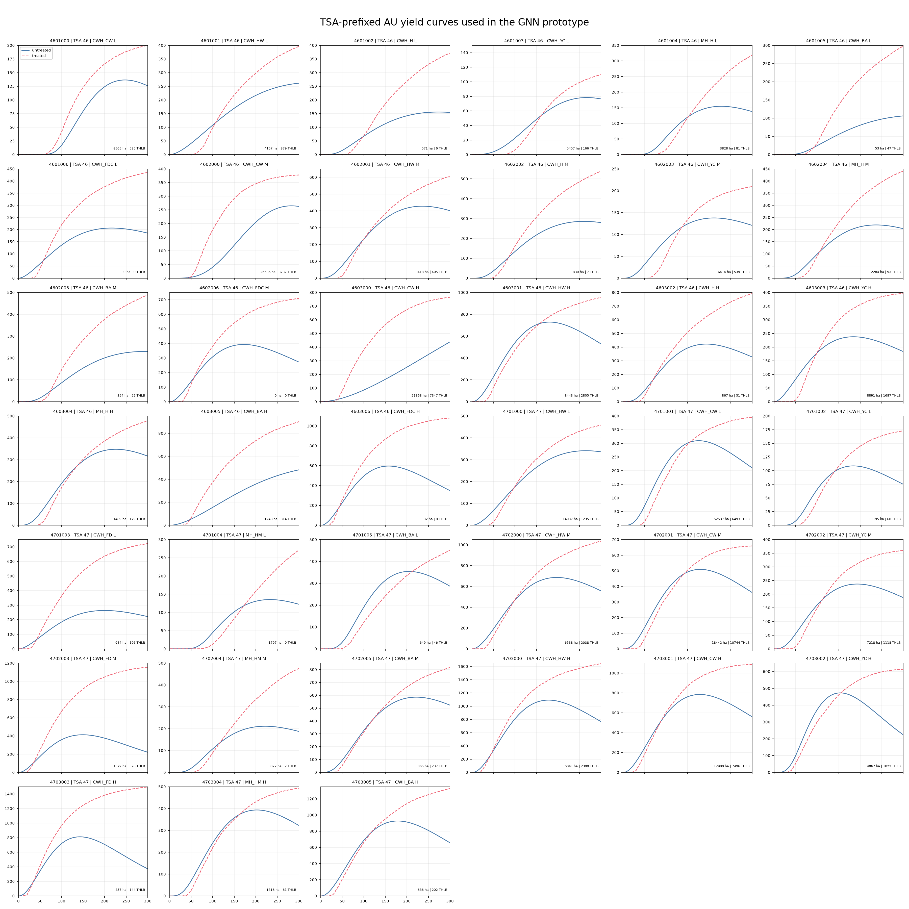

AU Curve Appendix
=================

This appendix contains the yield curves for all **39 TSA-prefixed analysis
units (AUs)** used by the prototype. They are the model inputs, not new curve
fits. Each AU has an untreated and a treated curve; the bars in the overview
and the linked plots use the curve IDs in the AU table.

The two TSA 46 CWH_FDC AUs with no clipped area are included because their
curve definitions remain part of the TSA 46 bundle. They are not scheduled.

   All 39 TSA-prefixed AU curves. Blue solid lines are untreated; red dashed
   lines are treated. The AU table and individual plots are below.

Individual AU plots
-------------------

The overview above contains all AUs. The table links to each full-size plot. Areas
are rounded to the nearest 0.1 thousand ha; THLB means timber harvesting land
base.

.. list-table::
   :header-rows: 1
   :widths: 16 6 14 6 12 12 24

   * - AU
     - TSA
     - Stratum
     - SI
     - Area (thousand ha)
     - THLB (thousand ha)
     - Curve plot
   * - ``4601000``
     - 46
     - CWH_CW
     - L
     - 8.6
     - 0.5
     - `plot <_static/figures/au_curves/4601000.png>`__
   * - ``4601001``
     - 46
     - CWH_HW
     - L
     - 4.2
     - 0.4
     - `plot <_static/figures/au_curves/4601001.png>`__
   * - ``4601002``
     - 46
     - CWH_H
     - L
     - 0.6
     - 0.0
     - `plot <_static/figures/au_curves/4601002.png>`__
   * - ``4601003``
     - 46
     - CWH_YC
     - L
     - 5.5
     - 0.2
     - `plot <_static/figures/au_curves/4601003.png>`__
   * - ``4601004``
     - 46
     - MH_H
     - L
     - 3.8
     - 0.1
     - `plot <_static/figures/au_curves/4601004.png>`__
   * - ``4601005``
     - 46
     - CWH_BA
     - L
     - 0.1
     - 0.0
     - `plot <_static/figures/au_curves/4601005.png>`__
   * - ``4601006``
     - 46
     - CWH_FDC
     - L
     - 0.0
     - 0.0
     - `plot <_static/figures/au_curves/4601006.png>`__
   * - ``4602000``
     - 46
     - CWH_CW
     - M
     - 26.5
     - 3.7
     - `plot <_static/figures/au_curves/4602000.png>`__
   * - ``4602001``
     - 46
     - CWH_HW
     - M
     - 3.4
     - 0.4
     - `plot <_static/figures/au_curves/4602001.png>`__
   * - ``4602002``
     - 46
     - CWH_H
     - M
     - 0.8
     - 0.0
     - `plot <_static/figures/au_curves/4602002.png>`__
   * - ``4602003``
     - 46
     - CWH_YC
     - M
     - 6.4
     - 0.5
     - `plot <_static/figures/au_curves/4602003.png>`__
   * - ``4602004``
     - 46
     - MH_H
     - M
     - 2.3
     - 0.1
     - `plot <_static/figures/au_curves/4602004.png>`__
   * - ``4602005``
     - 46
     - CWH_BA
     - M
     - 0.4
     - 0.1
     - `plot <_static/figures/au_curves/4602005.png>`__
   * - ``4602006``
     - 46
     - CWH_FDC
     - M
     - 0.0
     - 0.0
     - `plot <_static/figures/au_curves/4602006.png>`__
   * - ``4603000``
     - 46
     - CWH_CW
     - H
     - 21.9
     - 7.3
     - `plot <_static/figures/au_curves/4603000.png>`__
   * - ``4603001``
     - 46
     - CWH_HW
     - H
     - 8.4
     - 2.8
     - `plot <_static/figures/au_curves/4603001.png>`__
   * - ``4603002``
     - 46
     - CWH_H
     - H
     - 0.9
     - 0.0
     - `plot <_static/figures/au_curves/4603002.png>`__
   * - ``4603003``
     - 46
     - CWH_YC
     - H
     - 8.9
     - 1.7
     - `plot <_static/figures/au_curves/4603003.png>`__
   * - ``4603004``
     - 46
     - MH_H
     - H
     - 1.5
     - 0.2
     - `plot <_static/figures/au_curves/4603004.png>`__
   * - ``4603005``
     - 46
     - CWH_BA
     - H
     - 1.2
     - 0.3
     - `plot <_static/figures/au_curves/4603005.png>`__
   * - ``4603006``
     - 46
     - CWH_FDC
     - H
     - 0.0
     - 0.0
     - `plot <_static/figures/au_curves/4603006.png>`__
   * - ``4701000``
     - 47
     - CWH_HW
     - L
     - 14.9
     - 1.2
     - `plot <_static/figures/au_curves/4701000.png>`__
   * - ``4701001``
     - 47
     - CWH_CW
     - L
     - 52.5
     - 6.5
     - `plot <_static/figures/au_curves/4701001.png>`__
   * - ``4701002``
     - 47
     - CWH_YC
     - L
     - 11.2
     - 0.1
     - `plot <_static/figures/au_curves/4701002.png>`__
   * - ``4701003``
     - 47
     - CWH_FD
     - L
     - 1.0
     - 0.2
     - `plot <_static/figures/au_curves/4701003.png>`__
   * - ``4701004``
     - 47
     - MH_HM
     - L
     - 1.8
     - 0.0
     - `plot <_static/figures/au_curves/4701004.png>`__
   * - ``4701005``
     - 47
     - CWH_BA
     - L
     - 0.6
     - 0.0
     - `plot <_static/figures/au_curves/4701005.png>`__
   * - ``4702000``
     - 47
     - CWH_HW
     - M
     - 6.5
     - 2.0
     - `plot <_static/figures/au_curves/4702000.png>`__
   * - ``4702001``
     - 47
     - CWH_CW
     - M
     - 18.4
     - 10.7
     - `plot <_static/figures/au_curves/4702001.png>`__
   * - ``4702002``
     - 47
     - CWH_YC
     - M
     - 7.2
     - 1.1
     - `plot <_static/figures/au_curves/4702002.png>`__
   * - ``4702003``
     - 47
     - CWH_FD
     - M
     - 1.4
     - 0.4
     - `plot <_static/figures/au_curves/4702003.png>`__
   * - ``4702004``
     - 47
     - MH_HM
     - M
     - 3.1
     - 0.0
     - `plot <_static/figures/au_curves/4702004.png>`__
   * - ``4702005``
     - 47
     - CWH_BA
     - M
     - 0.9
     - 0.2
     - `plot <_static/figures/au_curves/4702005.png>`__
   * - ``4703000``
     - 47
     - CWH_HW
     - H
     - 6.0
     - 2.3
     - `plot <_static/figures/au_curves/4703000.png>`__
   * - ``4703001``
     - 47
     - CWH_CW
     - H
     - 13.0
     - 7.5
     - `plot <_static/figures/au_curves/4703001.png>`__
   * - ``4703002``
     - 47
     - CWH_YC
     - H
     - 4.1
     - 1.8
     - `plot <_static/figures/au_curves/4703002.png>`__
   * - ``4703003``
     - 47
     - CWH_FD
     - H
     - 0.5
     - 0.1
     - `plot <_static/figures/au_curves/4703003.png>`__
   * - ``4703004``
     - 47
     - MH_HM
     - H
     - 1.3
     - 0.1
     - `plot <_static/figures/au_curves/4703004.png>`__
   * - ``4703005``
     - 47
     - CWH_BA
     - H
     - 0.7
     - 0.2
     - `plot <_static/figures/au_curves/4703005.png>`__

Return to :doc:`aus`.
