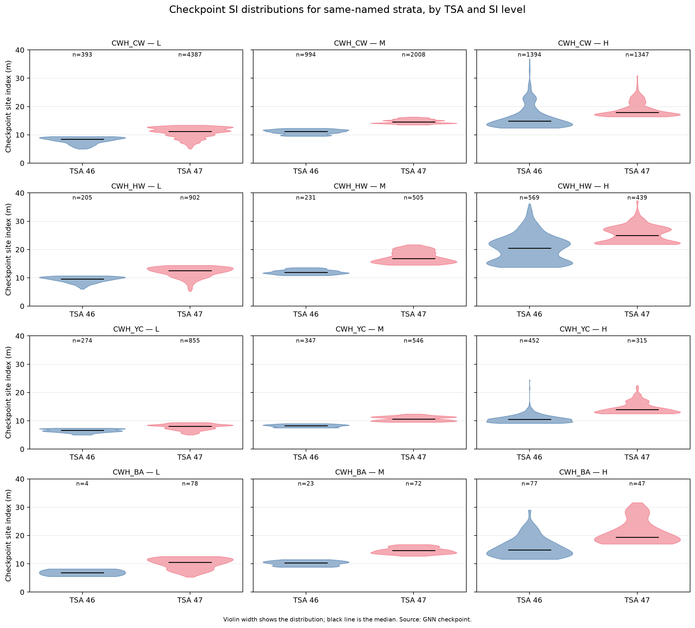

AU structure and harmonization
==============================

The prototype keeps **39 TSA-prefixed AUs**. Thirty-seven have clipped area;
two TSA 46 CWH_FDC AUs have no rows.

Why not merge?
---------------

Nominal matches such as ``CWH_CW H`` have very different TSA 46 and TSA 47
curves. Volume at age 100:

.. list-table::
   :header-rows: 1
   :widths: 22 18 15 15 15

   * - Group
     - Curve
     - TSA 46
     - TSA 47
     - Delta
   * - CWH_CW H
     - untreated
     - 85.5
     - 584.6
     - -85.4%
   * - CWH_CW H
     - treated
     - 379.7
     - 604.9
     - -37.2%
   * - CWH_HW H
     - untreated
     - 539.2
     - 807.5
     - -33.2%
   * - CWH_HW H
     - treated
     - 471.5
     - 936.5
     - -49.7%
   * - CWH_FD H
     - untreated
     - 495.0
     - 718.8
     - -31.1%
   * - MH_HM H
     - untreated
     - 191.2
     - 242.2
     - -21.1%

Merging would require choosing one curve and hiding the other provenance.
Instead, the model keeps TSA-specific AUs and uses a **reporting-only crosswalk**
(``CWH_FDC`` -> ``CWH_FD``, ``MH_H`` -> ``MH_HM``).

   Checkpoint site index distributions for same-named strata, by TSA and SI
   level. Violin width shows the distribution; the black line is the median.
   Source: GNN checkpoint. The distributions are not pooled in the model.

The figure shows the SI evidence behind the same-named cells. It does not make
the curves interchangeable: TSA 46 and TSA 47 retain separate AUs. See
:doc:`au-curves` for all 39 AU curve plots and the untreated/treated comparison.

Concentration
-------------

CWH_CW is about **67.6%** of the derived THLB. The largest single cells are
TSA 47 CWH_CW M (20.3%), TSA 47 CWH_CW H (14.1%), TSA 46 CWH_CW H (13.9%),
and TSA 47 CWH_CW L (12.3%).

Caveat
------

TSA 46 validation found checkpoint SI understates managed-stand SI. The GNN
chunk inherits that issue. It is a base-model accuracy question, not a reason
to merge AUs. No curve or AAC target was changed.

Files: ``config/tsr/gnn_au/`` and ``notes/reference/au-harmonization.md``.

Inherited TSA 46 SI issue
-------------------------

TSA 46 height validation found that the checkpoint SI understates managed-stand
SI in the dominant CWH_HW H cell: 16.3 m in the checkpoint versus 23.0-26.0 m
observed. A holdout managed-SI test reduced the height bias, but a managed-SI
switch can overcorrect VRI audits and needs an origin-separated decision first.

TSA 46 is **34.7%** of the GNN THLB. The largest exposure is CWH_CW H (13.9%),
followed by CWH_CW M (7.1%) and CWH_HW H (5.3%). The strongest evidence is for
CWH_HW H; do not generalize the correction to every TSA 46 AU.

The base-model issue is `UBC-FRESH/femic#343 <https://github.com/UBC-FRESH/femic/issues/343>`_.
The GNN model keeps TSA-prefixed AUs and does not switch curves until that issue
records an origin-separated decision. No AAC tuning.
